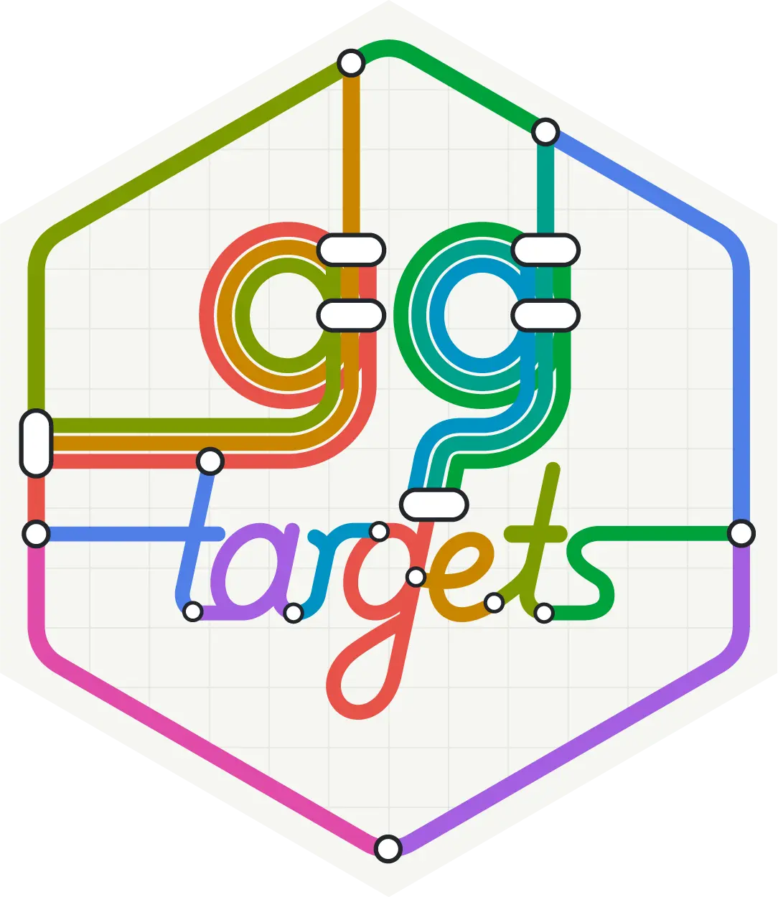
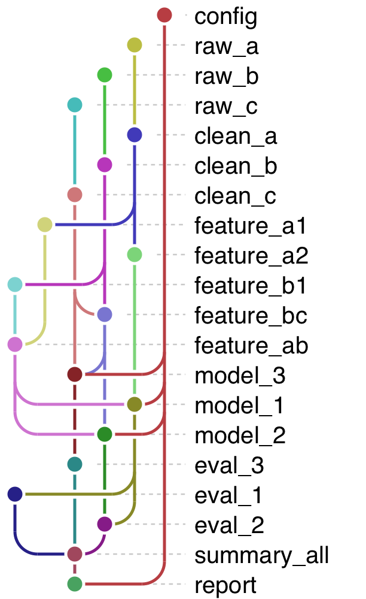
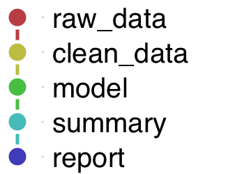
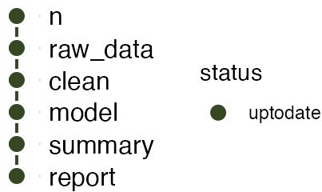
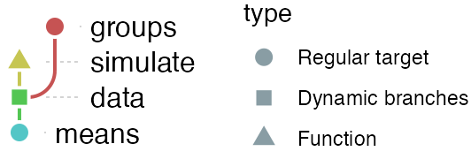
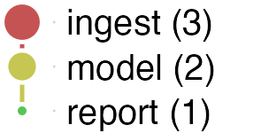
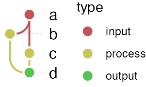

# ggtargets <a href='https://github.com/royfrancis/ggtargets'></a>

[](https://github.com/royfrancis/ggtargets/actions/workflows/linux.yml) [](https://github.com/royfrancis/ggtargets/actions/workflows/windows.yml) [](https://app.codecov.io/gh/royfrancis/ggtargets/) [](https://royfrancis.r-universe.dev/ggtargets) 

**ggtargets** creates metro-style diagrams of the dependency graphs of [targets](https://docs.ropensci.org/targets/) pipelines, and of other directed acyclic graphs, using ggplot2.



## Installation

Install from GitHub:

``` r
# install.packages("remotes")
remotes::install_github("royfrancis/ggtargets")
```

## Quick start

Inside a `targets` project:

``` r
library(ggtargets)
tar_ggplot()
tar_ggplot(node_color = "status", palette = targets_status_colors())
```

## Example: a `targets` pipeline

``` r
withr::with_dir(withr::local_tempdir(), {
  targets::tar_script(list(
    tar_target(n, 20),
    tar_target(raw_data, data.frame(x = seq_len(n), y = seq_len(n) * 2 + rnorm(n))),
    tar_target(clean, raw_data[complete.cases(raw_data), ]),
    tar_target(model, lm(y ~ x, data = clean)),
    tar_target(summary, coef(model)),
    tar_target(report, capture.output(print(summary)))
  ))
  tar_ggplot()
})
```



Color by build status to see what's out of date at a glance:

``` r
withr::with_dir(withr::local_tempdir(), {
  targets::tar_script(list(
    tar_target(n, 20),
    tar_target(raw_data, data.frame(x = seq_len(n), y = seq_len(n) * 2 + rnorm(n))),
    tar_target(clean, raw_data[complete.cases(raw_data), ]),
    tar_target(model, lm(y ~ x, data = clean)),
    tar_target(summary, coef(model)),
    tar_target(report, capture.output(print(summary)))
  ))
  targets::tar_make(reporter = "silent")
  tar_ggplot(node_color = "status", palette = targets_status_colors())
})
```



Nodes are drawn by their type, as `targets::tar_visnetwork()` does: a circle for a regular target, a square for a dynamic-branching one, and an up and a down triangle for imported functions and objects (which are in the graph with `targets_only = FALSE`). A legend names the shapes:

``` r
withr::with_dir(withr::local_tempdir(), {
  targets::tar_script({
    simulate <- function(group) rnorm(10, mean = match(group, letters))
    list(
      tar_target(groups, letters[1:3]),
      tar_target(data, simulate(groups), pattern = map(groups)),
      tar_target(means, vapply(data, mean, numeric(1)))
    )
  })
  tar_ggplot(targets_only = FALSE)
})
```



A pipeline of many targets is easier to read as a few stages. `targets` has no tag field for a target, but its `description` is free text, so a stage can go there (`tar_option_set(description = )` sets it for a block of targets). `collapse_by = "description"` merges the targets that share one into a node, with their number in the label, and `node_size` and `edge_width` show those counts:

``` r
withr::with_dir(withr::local_tempdir(), {
  targets::tar_script({
    tar_option_set(description = "ingest")
    ingest <- list(
      tar_target(raw_data, 1:10),
      tar_target(clean_data, raw_data * 2),
      tar_target(features, clean_data + 1)
    )
    tar_option_set(description = "model")
    model <- list(
      tar_target(fit_mean, mean(features)),
      tar_target(fit_median, median(features))
    )
    tar_option_set(description = "report")
    report <- list(tar_target(report_text, c(fit_mean, fit_median)))
    tar_option_set(description = character(0))
    c(ingest, model, report)
  })
  tar_ggplot(collapse_by = "description", node_size = "n", edge_width = "n")
})
```



See the "Collapsing a pipeline by stage" section of `?tar_ggplot` for the details, and for a column of your own instead of `description`.

## Example: any directed acyclic graph

`ggplot_dag()`/`as_dag()` work with any edge-list data frame, not just a `targets` pipeline:

``` r
edges <- data.frame(from = c("a", "a", "b", "c"), to = c("b", "c", "d", "d"))
nodes <- data.frame(name = c("a", "b", "c", "d"), type = c("input", "process", "process", "output"))
ggplot_dag(as_dag(edges, nodes = nodes), node_color = "type")
```



See `vignette("ggtargets")` to get started, and `browseVignettes("ggtargets")` for more (customizing the style, other inputs, how the layout works). A few more articles
(collapsing a pipeline, colors, working with ggplot2, a gallery) are pkgdown-only for now, since the package doesn't ship them to keep install-time dependencies light - build the site locally with `pkgdown::build_site()` to read them.

## Acknowledgements

The metro style and its default color palette are reproduced from [dagviz](https://pypi.org/project/dagviz/) by Wim Yedema (Apache-2.0), and the workflow-diagram use case is inspired by
[snakevision](https://github.com/OpenOmics/snakevision) by OpenOmics (MIT). The code was mostly rewritten by Anthropic AI models Claude Sonnet 5 and Opus 5.5. ggtargets is an independent package: it is not part of rOpenSci's targets project.

---

2026 • Roy Francis
